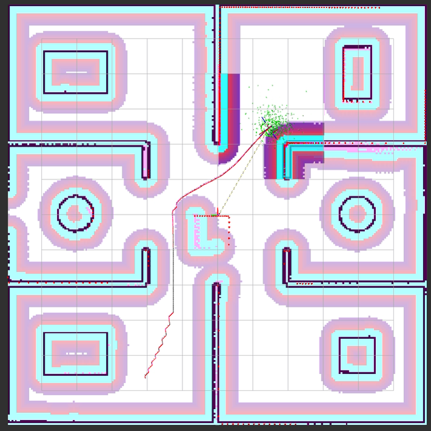

# Autonomous Mobile Robot (AMR) — ROS 2 Humble, Graph-SLAM & Nav2

[](https://scidelo-andriasahy.github.io/?project=1)
[](https://docs.ros.org/en/humble/)
[](https://navigation.ros.org/)

> **Author:** Tsikomia Scidelo ANDRIASAHY — Final-Year GSEA Engineering Student (ENSA Tangier)  
> **Live Project Showcase:** [https://scidelo-andriasahy.github.io/?project=1](https://scidelo-andriasahy.github.io/?project=1)



## Overview
Complete design, digital twin simulation, and experimental validation of a differential-drive **Autonomous Mobile Robot (AMR)** running **ROS 2 Humble** on Ubuntu 22.04 LTS:
- **Digital Twin (Gazebo & URDF/Xacro):** Rigid-body inertia tensors, collision meshes, differential-drive kinematics (`/odom`), 360° 2D LiDAR (`/scan`), and IMU (`/imu/data`).
- **Deterministic TF2 Coordinate Tree:** `map -> odom -> base_footprint -> base_link -> laser_frame`.
- **Asynchronous Graph-SLAM (`slam_toolbox` + Ceres Solver):** Real-time 2D Occupancy Grid mapping with nonlinear loop-closure optimization eliminating odometry drift.
- **Autonomous Navigation (`Nav2`):** Multi-layer 2D Costmaps (*Static, Obstacle, Inflation*), global path planning (**NavFn / A\***), and local dynamic obstacle avoidance (**DWB — Dynamic Window Approach**).

## Repository Structure
```text
├── docs/          # Technical report PDF, ROS 2 node/topic graphs, Xacro & SLAM diagrams
└── media/         # Gazebo/RViz2 captures, TF2 tree, workflow diagram, and WebM navigation demos
```

## Documentation & Demos
- Full Technical Report: [docs/Rapport_Projet_AMR_ROS2.pdf](docs/Rapport_Projet_AMR_ROS2.pdf)
- ROS 2 Nodes Architecture: [docs/ArchitectureROS2Node.pdf](docs/ArchitectureROS2Node.pdf)
- Navigation & Teleoperation Demo Videos: `media/ros2_amr_navigation.webm`, `media/ros2_amr_teleop.webm`
