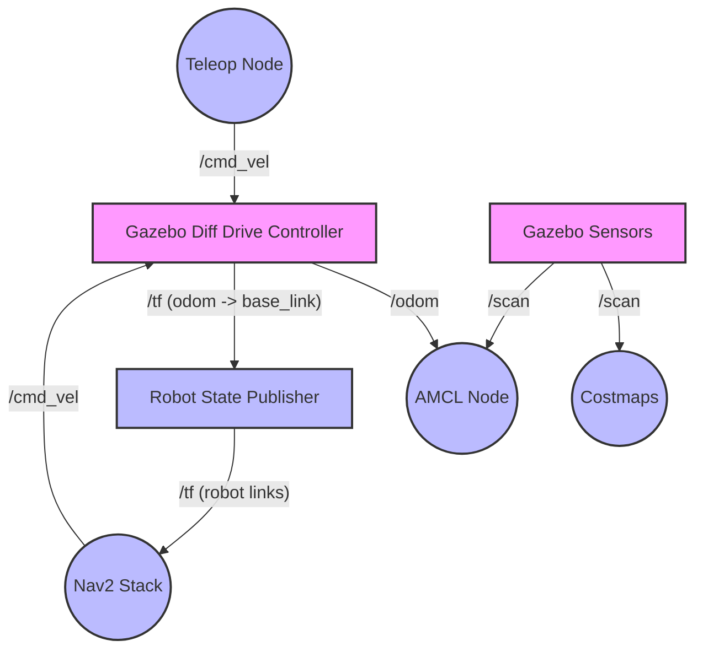
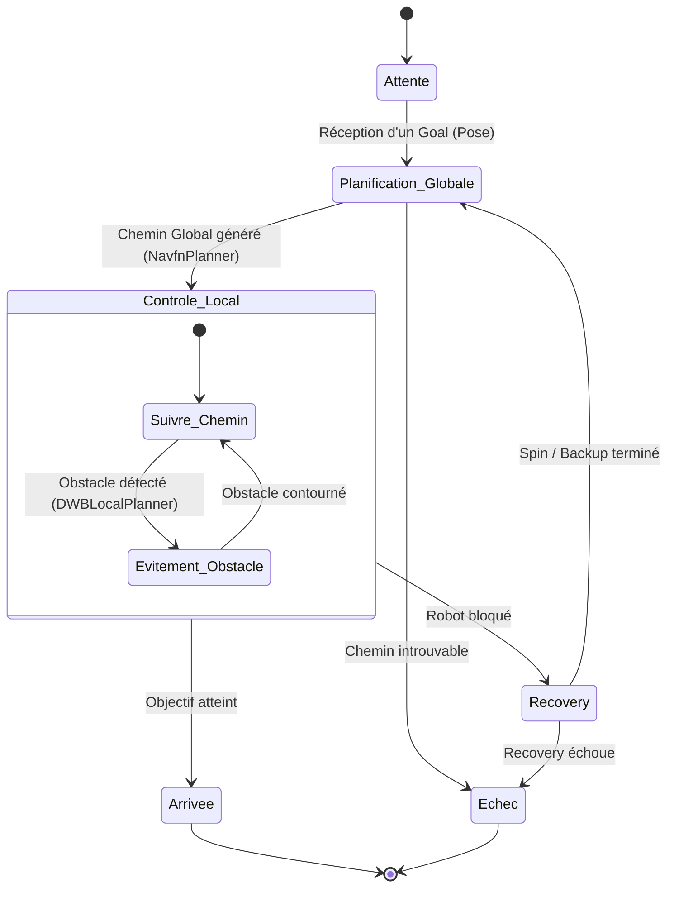

# Rapport d'Analyse : Autonomous Mobile Robot ROS 2

## 1. Vue d'Ensemble du Projet

Ce projet implémente un robot mobile autonome à entraînement différentiel (Differential Drive) sous **ROS 2**. Il est conçu pour être simulé dans **Gazebo** et utilise la stack **Nav2** pour la navigation autonome, la planification de trajectoire et l'évitement d'obstacles.

**Technologies principales :**
*   **ROS 2** (Middleware robotique)
*   **Gazebo** (Moteur de simulation 3D)
*   **Nav2** (Stack de navigation)
*   **URDF / Xacro** (Description physique du robot)
*   **RViz2** (Visualisation des données)

---

## 2. Architecture Physique du Robot

Le modèle physique du robot (défini via Xacro/URDF) est composé d'un châssis principal, de deux roues motrices et d'une roue folle (caster), avec des capteurs embarqués.

### Composants Physiques et Capteurs

| Composant | Type / Fichier Xacro | Rôle |
| :--- | :--- | :--- |
| **Base / Châssis** | `robot_include.xacro` | Structure principale (boîte 30x30x15cm) portant les autres éléments. |
| **Roues Motrices** | `robot_include.xacro` | 2 roues (gauche et droite) cylindriques contrôlant le mouvement. |
| **Caster** | `robot_include.xacro` | Roue sphérique (folle) à l'avant pour l'équilibre (frottement réduit). |
| **LiDAR** | `lidar.xacro` | Capteur laser 2D scannant l'environnement pour créer la carte et éviter les obstacles (`/scan`). |
| **IMU** | `imu.xacro` | Unité de mesure inertielle fournissant l'orientation et l'accélération (`/imu`). |
| **Contrôleur** | `control.xacro` | Plugin Gazebo traduisant les commandes de vitesse (`/cmd_vel`) en rotation des roues. |

---

## 3. Architecture Logicielle et Flux de Données (ROS 2)

Le système est distribué sur plusieurs nœuds ROS 2 qui communiquent via des topics. Voici le flux d'information global :



### Explication des interactions :
1.  **Entrées Utilisateur/Système** : Le nœud de téléopération (`teleop.py`) ou la stack Nav2 publient des consignes de vélocité sur le topic `/cmd_vel`.
2.  **Simulation** : Le plugin Gazebo (`gazebo_ros_diff_drive`) écoute `/cmd_vel`, fait bouger le robot dans la simulation 3D et publie son odométrie sur `/odom`.
3.  **Capteurs** : Les capteurs virtuels publient les données environnementales, notamment le LiDAR sur `/scan`.
4.  **Localisation** : **AMCL** utilise la carte préexistante (`my_map.yaml`), l'odométrie et le `/scan` pour estimer la position du robot sur la carte (transform `map -> odom`).
5.  **État du robot** : Le **Robot State Publisher** lit l'URDF et publie les transformations cinématiques (`/tf`) entre toutes les pièces du robot.

---

## 4. Environnement de Simulation (Gazebo)

L'environnement de test est défini dans `world/diff_robot.world`. Il représente une maison (nommée "maison") comprenant :
*   **Dimensions** : Murs extérieurs formant un espace de 12x12 mètres.
*   **Agencement** : 4 pièces réparties par une croix centrale (murs intérieurs avec portes de 2m de large).
*   **Obstacles (Meubles)** : 
    *   Une table et un canapé dans les pièces du bas.
    *   Deux lits dans les pièces du haut.
    *   Des cylindres décoratifs ou obstacles dans le couloir.

---

## 5. Navigation et Comportement (Nav2)

La stack de navigation est configurée via `config/nav2_params.yaml`. Le pipeline de comportement autonome suit ce workflow :



### Paramètres de Navigation Clés :
*   **Limites de Vitesse** : Vitesse linéaire max de **1.0 m/s** et vitesse de rotation max de **2.0 rad/s**. (Définies dans Teleop et le contrôleur DWB).
*   **Costmaps (Cartes de coût)** :
    *   *Global Costmap* : Basée sur la carte statique (`my_map.pgm`) + inflation.
    *   *Local Costmap* : Mise à jour à 5 Hz, fenêtre roulante (3x3m) basée sur le LiDAR en temps réel.
*   **Planners** : Utilisation de `NavfnPlanner` (A*) pour le chemin global, et de `DWBLocalPlanner` pour le contrôle fin de la trajectoire locale.

---

## 6. Workflow : Comment Tester et Simuler le Robot

Pour simuler et interagir avec le projet, suivez ces étapes dans des terminaux séparés (après avoir sourcé l'environnement ROS 2 `source install/setup.bash`).

### Étape 1 : Lancer la Simulation Gazebo
Ce script charge l'URDF du robot, l'injecte dans le monde Gazebo ("maison") et démarre le Robot State Publisher.
```bash
ros2 launch diff_robot rsp_gazebo.launch.py
```

### Étape 2 (Option A) : Contrôle Manuel (Teleop)
Pour piloter le robot manuellement au clavier et vérifier la physique (les collisions, la stabilité de la roue caster).
```bash
ros2 run diff_robot teleop
```
*Utilisez les touches `u, i, o, j, k, l, m, ,, .` pour diriger, et `q, z` pour gérer la vitesse.*

### Étape 2 (Option B) : Lancer la Navigation Autonome (Nav2 & RViz)
Pour tester l'évitement d'obstacles et le pathfinding automatique.
```bash
ros2 launch diff_robot navigation.launch.py use_sim_time:=true
```
**Dans RViz2 :**
1. Utilisez l'outil **"2D Pose Estimate"** pour indiquer au système où se trouve initialement le robot dans la carte.
2. Utilisez l'outil **"Nav2 Goal"** (ou "2D Nav Goal") pour cliquer sur une destination cible. Le robot calculera le chemin et s'y rendra.
